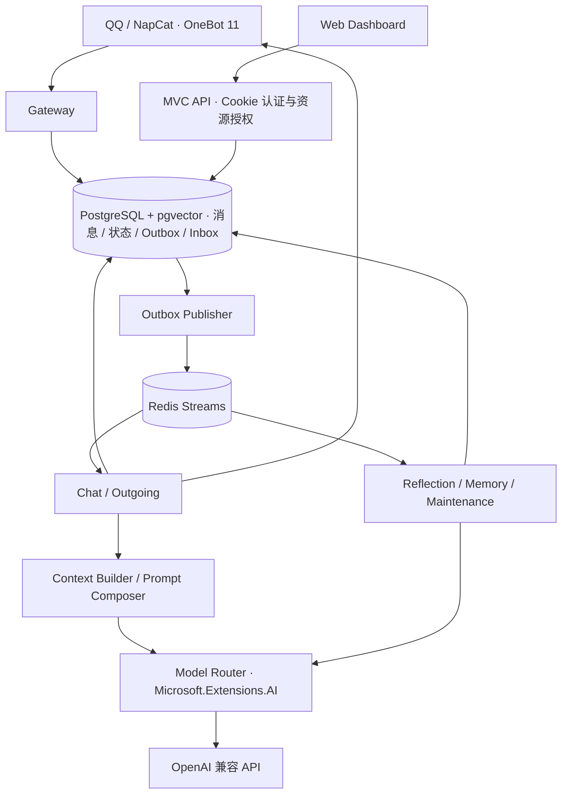

# Wonder 核心架构

Wonder 是一个基于 QQ 的、多实例 AI 聊天机器人平台。每个逻辑 Bot 拥有独立身份、模拟心境、关系、记忆和模型配置。本文保留 v0.1 的核心设计与当前实现边界，操作步骤见 [运行指南](operations.md)，接口以 [API 说明](api/README.md) 和 OpenAPI 为准。

## 设计原则

1. 身份稳定，心境有惯性，关系变化有证据；不让一次互动任意改写角色。
2. PostgreSQL 是业务权威存储，Redis 负责队列与缓存；Redis 丢失后可恢复未完成任务。
3. LLM 生成 Proposal，由服务端验证授权、证据、版本与变化幅度后提交。
4. 记忆在服务端按 Bot、用户、会话范围和授权过滤；Owner 管理权不等于读取用户私人记忆的权限。
5. 用户可以查看、更正、删除记忆；撤销必须阻止旧任务回写，并处理派生上下文。
6. 心境是角色的模拟表达状态，不宣称真实主观体验，也不通过情感施压促使用户继续聊天。

## 系统结构

.NET 10 / ASP.NET Core 模块化单体，一个 Host、一个 DbContext、一套 EF Core Migrations。PostgreSQL + pgvector 与 Redis 作为独立服务运行，当前任务消费仅支持单 Host。



| 模块 | 职责 |
| --- | --- |
| `Wonder.Host` | HTTP、原生 HTML / CSS / JavaScript 控制台、认证、连接与后台调度 |
| `Wonder.Core` | 领域实体、标识、状态与事件契约 |
| `Wonder.Platforms` | OneBot 传输、消息标准化、回复格式化 |
| `Wonder.Chat` | 对话编排、上下文预算、历史窗口与滚动摘要 |
| `Wonder.Persona` | Shared / Identity / Emotion 编译、身份版本 |
| `Wonder.Emotion` | 心境演化、关系证据聚合、独立叙事 |
| `Wonder.Memory` | 记忆准入、作用域规则、检索与撤销 |
| `Wonder.AI` | 模型适配、任务路由、能力与用量 |
| `Wonder.Infrastructure` | EF Core、Redis、持久化工作流、媒体与备份 |

模块规则通过 C# 接口协作，可靠异步工作通过 Outbox 和 Streams 交接。业务读写以 EF Core 为主，工作流集中在 Infrastructure。

## 身份、提示与上下文

```text
System Prompt = Shared Prompt + Identity Prompt + Emotion Prompt

Shared    系统行为、安全与工具边界
Identity  Owner 手动发布的最小角色身份，历史版本不可变
Emotion   从已验证的结构化心境编译的表达状态

Reference Context（不可信参考数据）
  授权关系信息 + 长期记忆 + 滚动摘要 + 近期历史 / 引用

Current User Message
```

聊天内容不能覆盖 Shared 或 Identity。关系与记忆以参考数据进入上下文，不能将其原文提升为系统指令。表达上以约 40% 角色自主性、60% 关系驱动为设计取向，比例不作为强制算术权重。

每次模型请求固定 Context Snapshot，记录身份、心境、关系、摘要版本以及检索记忆来源，避免异步更新改变同一轮请求的依据。上下文先预留输出、协议开销与安全余量，保留系统规则、身份和当前消息，再按预算组合历史、摘要与记忆。

群聊使用会话范围内稳定的匿名发言者标签，当前消息、历史、引用和摘要沿用作者归属。用户主动设置的称呼按作者传入；Identity 中的名字只属于 Bot。旧摘要缺失的作者信息不推测补全。具体操作见 [用户称呼](shared-context.md)。

## 心境、关系与反思

- **Global Mood**：每 Bot 一份 Valence / Arousal / Energy 状态及版本；以惯性、限幅和向基线自然回归保持连续性。
- **Relationship**：按 `(BotId, UserId)` 保存偏好、边界与交流模式，依赖来源证据聚合，并受使用范围约束。
- **Reflection**：轻量反思处理符合授权的触发消息；会话明确结束（`/end`、`/结束`）或空闲超时后，对固定消息范围进行完整反思，复杂情况交由 StrongReflection 复核。
- **提交**：模型输出结构化 Proposal；服务端校验权限、证据、版本、去重与变化上限。情绪事件按 Bot 顺序应用，关系按 Bot / 用户控制并发，单个用户每日影响次数受限。
- **Daily Narrative**：从已提交状态生成独立叙事，失败可单独重试；当前仅在控制台展示，不写回权威心境，也不注入聊天上下文。

心境演化遵循以下形式，B 为基线、λ 为按时间衰减的系数、ΔE 为通过验证的事件影响：

```text
M(t + Δt) = Clamp(B + λ^Δt · (M(t) - B) + α · ΔE)
```

每次演化记录时间与版本，避免重复衰减；并发冲突后重读状态，重新应用同一已验证 Proposal，无需再次调用模型。

会话空闲时间按私聊 / 群聊配置，初始为十分钟。关闭时固定反思范围，检查未完成的生成与发送；关闭边界后的新消息进入新 Session。同一 Conversation 的有效近期消息和最新摘要跨 Session 延续，普通已保存群消息也可进入上下文。每轮注入当前时钟、时区和消息时间；具体读取与工具行为见 [对话延续与时间](conversation-continuity.md)。

## 长期记忆与授权

长期记忆默认关闭。用户通过五分钟有效的一次性口令，在可信 QQ 私聊连接中验证绑定后自行开启；平台身份与网页登录账号分离。

| 范围 | 读取边界 |
| --- | --- |
| `Private` | 本人私聊 |
| `GroupUser` | 来源群内、本人的对话 |
| `GroupShared` / `GlobalPublic` | 按服务器公共范围规则读取；不会从单人的陈述自动创建 |
| `UserShared` | 作者逐条授权，同一 Bot 内本人跨群 / 私聊使用 |
| `SpaceShared` | 作者逐条授权，来源群与目标群须属于同一 Bot 的同一共享空间 |

自动写入只接收已授权、明确、非敏感且有长期价值的事实，先检查来源、权限、冲突与去重，再保存事实并异步生成 Embedding。当前冲突候选保守忽略，未提供候选审核界面。

向量按 Embedding Profile 隔离供应商、模型和维度。当前以 PostgreSQL `real[]` 保存，在查询中转换为 pgvector `vector` 计算余弦距离；仅转换、距离运算及 Profile 筛选使用参数化 SQL，EF LINQ 将授权过滤、关联、距离排序和 Top-K 组合在同一查询中。先限制可访问范围再取最近结果，当前使用精确检索，不依赖 HNSW。

共享保存为独立副本，读取时再次验证作者开关、原始记忆状态及来源 / 目标群空间。退出或删除空间会停用对应共享；开启共享开关不会自动发布历史记忆。详见 [跨群记忆](shared-context.md)。

### 更正、删除与派生数据

更正或删除原始记忆会撤回共享副本，更正后的记忆需要重新共享。撤销事务记录范围与 Epoch，旧反思、Embedding 和其他写入任务提交前必须再次检查，防止删除后重新写回。

共享撤回按来源将受影响的助手历史和摘要标为不可用于后续上下文，保留原文供诊断，并取消关联待发送回复。来源为空或损坏的缓存保守失效。删除原始记忆还会清理本人相关向量、关系、反思、摘要、图片与回复缓存，可能损失部分无关近期上下文；本地操作无法收回已发送到 QQ 的内容。

## 可靠聊天链路

1. NapCat 正向 WebSocket 接收入站消息，标准化文本、图片、@ 和引用；按群策略决定触发。保存、回复与反思分别判断，未触发群消息不默认提取长期记忆。
2. 消息与 Outbox 在同一 PostgreSQL 事务提交，以平台消息标识去重；Redis 只传 EventId 等元信息。
3. Publisher 允许重复发布；Consumer Group 领取任务，业务效果与 Inbox 同事务提交后确认消费，失败有限重试并进入持久失败记录 / DLQ。
4. 同一对话检查前序聊天及未完成发送，再固定上下文并调用模型；模型调用期间不持有长数据库事务。
5. 完整回复先持久化，再按自然段和长度限制分段发送，每段分别记录状态及平台回执。

Outbox 同时保存持久任务状态，数据库短租约防止重复领取；Redis 丢失后可重新发布未完成工作。聊天有两个消费者，其余任务流各一个；当前不保证多 Host 共同消费。

外部 QQ 发送无法保证严格 exactly-once。连接中断或崩溃后无法判断是否已送达的分段标为 `DeliveryUnknown`，由人工核对后确认已发送或允许重试，后者可能产生重复。

## 模型与预算

任务独立配置 `Chat`、`LightReflection`、`StrongReflection`、`DailyNarrative`、`RollingSummary`、`Embedding`，可复用同一供应商或模型。通过 Microsoft.Extensions.AI 的 `IChatClient` / `IEmbeddingGenerator` 适配兼容 API。

生成采用完整响应，仅最终 content 可发送到 QQ，reasoning_content 不作为回复。图片、JSON、思考开关与强度按模型能力显式配置；Embedding 使用独立模型与向量空间。聊天路由可显式开启只读工具 get_current_time 与 search_conversation_history，默认关闭；后者由服务端限定为当前 Conversation 的有效历史。工具链有轮次限制，计入用量，仅最终回答可发送。不跨供应商自动切换，也未实现本地 Embedding 进程。

调用前检查 Bot 的日 / 月预算，记录实际用量或保守估算；当前预算为准入检查，尚无并发精确预留及按任务独立额度。配置操作见 [模型路由](model-routes.md)。

## 运行、保留与恢复

- Cookie 登录与 Owner 资源级授权；有副作用的 API 还要求 `X-Wonder: 1`。模型密钥和 QQ 令牌用 Data Protection 保护，接口只返回是否已配置。
- 原始消息默认保留九十天，按创建时配置保存到期时间；图片缓存七天，已完成发送正文缓存三十天。长期记忆与关系不随原始消息自动过期。
- 图片仅下载 HTTPS 公网地址，不跟随跳转；每轮最多三张、单张 5 MiB，每 Bot 缓存约 128 MiB。媒体和密钥放在私有目录。
- 迁移在部署时显式执行，普通启动不自动迁移。Compose 与 rootless Podman Quadlet 均使用单 Host 模式。
- 手动备份通过 `pg_dump` 流式 age 加密；Data Protection 密钥另行保存。配置 age 收件人后，删除事务排入独立账本导出任务。
- 恢复时先停止应用，恢复数据库与密钥、执行迁移，再重放最新独立删除账本，验证撤销与授权后启动。数据库与账本一起丢失时，无法保证恢复后仍包含最新删除记录。

目标主机基线为 4 vCPU / 8 GiB，应用、PostgreSQL、Redis 合计按约 4 GiB 预算规划，仍需压测。默认部署限制只是起点，不能视为容量保证。实际命令与排错见 [运行指南](operations.md)。

## 当前边界与待验证项

- 账号暂未提供邮箱验证、密码找回和完整账号管理。
- 主动发言调度、音视频与任意文件的完整处理、长期任务 / 用量 / 情绪事件分级归档及更丰富告警尚未实现。
- 自动化测试使用模拟模型与 QQ 发送适配器；提供真实 PostgreSQL / pgvector / Redis 集成测试。测试范围与执行方式见 [测试指南](../tests/README.md)。
- 真实 NapCat / 模型供应商兼容性、容器与 Quadlet 运行、目标机器负载及备份恢复演练仍需实测；模拟测试不能代替这些验收。
