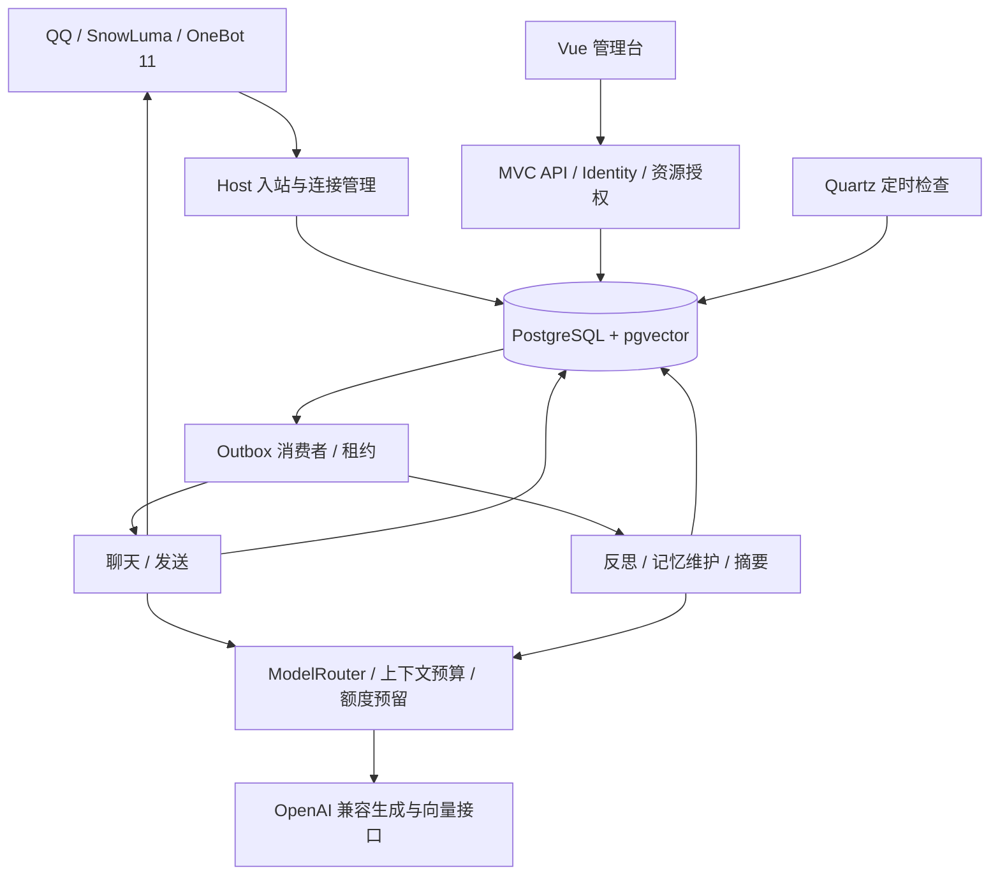

# Wonder 核心架构

Wonder 是基于 QQ 的多 Bot AI 聊天平台。每个 Bot 拥有独立身份、模拟心境、关系、记忆与模型配置。本文描述当前代码的职责和运行边界；部署与恢复见 [运行指南](operations.md)。

记忆版本、精确来源、隐私清理见 [Memory 生命周期](memory-lifecycle.md)。交互工具和 Notes 的事务边界见 [交互工具与 Notes](agent-tools.md)。

## 系统结构

.NET 10 / ASP.NET Core 模块化单体，使用一个 Host、一个业务 DbContext 和一套 EF Core Migrations。Vue 管理台由 Host 同源托管。PostgreSQL + pgvector 保存业务数据、Outbox 持久任务和 Quartz 调度状态。完整应用按单 Host 部署。



| 项目 | 当前职责 |
| --- | --- |
| `Wonder.Host` | MVC API、认证配置、OneBot 连接、Features 工作流、模型预算、任务消费和 Quartz 调度 |
| `Wonder.Web` | Vue 3、TypeScript、Arco Design Vue 管理台 |
| `Wonder.Core` | 领域实体、状态、消息和事件契约 |
| `Wonder.Platforms` | OneBot 消息标准化、触发判断、回复分段及发送接口 |
| `Wonder.Infrastructure` | EF Core / Npgsql、pgvector、任务领取、模型传输、Tokenizer、媒体、密钥保护 |

HTTP 字段校验使用 FluentValidation，账号与 Cookie 使用 ASP.NET Core Identity。模型传输使用 OpenAI .NET SDK 和 Microsoft.Extensions.AI；Wonder 定义授权、证据、角色行为、会话顺序、预算及撤销等业务规则。

## 身份、提示和对话上下文

```text
System = Shared 行为边界 + Owner 发布的 Identity + 已验证的 Emotion 表达状态
Reference = 授权关系 + 长期记忆 + 滚动摘要 + 近期历史与引用
Current = 当前用户消息
```

Identity 描述 Bot 自身，历史版本保留；用户称呼来自经过 QQ 验证的本人设置。关系、记忆、历史和工具结果均作为不可信参考数据，不能覆盖系统规则。发言者通过 Conversation 范围内稳定的匿名标签区分。

Conversation 对应一个私聊或群聊；Session 用于空闲结束和任务分段。私聊上下文可以跨 Session 延续，读取有效摘要及摘要之后最近 40 条有效消息，再按预算选择。群聊只提供基础聊天和当前发言者识别，不读取历史、摘要、关系或记忆。

每轮固定来源快照，记录身份、心境、关系、摘要版本及记忆、原消息和作者来源；Notes 版本另外通过依赖边传递。只保留消息时间与固定时区，当前钟点按需调用时间工具；私聊可启用历史工具。写工具另需独立服务端能力开关、有效 Chat 租约及本人授权。详见 [对话延续与时间](conversation-continuity.md)。

## 反思、心境与关系

- 用户长期记忆默认关闭。开启后，符合回复及持久化条件的私聊消息可触发即时反思；群聊不再生成或应用 Reflection。
- 每条合格消息排入 `light`；会话空闲到期或主动结束后，按发言者排入 `full`。默认私聊和群聊均空闲 10 分钟结束，每 15 秒检查，并等待聊天、发送任务完成。
- light 和 full 均先调用 `LightReflection`；模型要求复核时才调用 `StrongReflection`。长内容分批并保存进度，完成后发布一份结果，再派生 Emotion、Relationship、Memory 任务。
- 主动 Full 不结束聊天，按 Bot 共用每日 2 Normal + 1 Important；与自动 Full 按有效用户来源签名共享规范运行，助手消息增加 Boundary 不导致重复分析。过程与下游进度分别展示。
- 每 Bot 一份全局模拟心境，包含 Valence、Arousal、Energy。演化时按经过小时数自然回归基线，并将单事件各维度变化限于 ±0.08；状态保存时间与版本。
- 情绪应用检查证据重复，同一用户对同一 Bot 每个 UTC 日最多应用 5 次。关系初次准入保留明确偏好或独立消息数门槛，并以逐项来源/资格区分当前、待核验和推断参考；失源不能仅凭票数判定充分，独立交流边界不改变服务器权限。
- 日常维护按 `Chat:TimeZone` 的零点排入，每 5 分钟补查当日遗漏；停机恢复只补当日。维护仅推进心境。

完整触发链路见 [Reflection 与 Memory](reflection-memory.md)。模拟心境是角色表达状态，不宣称真实主观体验。

## 长期记忆与授权

用户先通过 5 分钟有效的一次性口令在 QQ 私聊绑定身份，再由本人选择是否开启自动学习；管理已有记忆不要求开启自动学习。Bot Owner 管理权不包含读取其他用户私人记忆的权限。

Memory 只存在于同一 Bot 的本人私聊，以 BotId + SubjectId 表达所有权。共享 API、ContextSpace、共享副本及 Scope/ScopeOwnerId 字段已删除，群聊没有个人上下文读取能力。

自动生成仅接受已授权、明确、非敏感且有本人证据的事实。Memory 先保存候选，MemoryMaintenance 在同一作者及作用域内对照已有事实，决定新增、合并、补充、更新、归档或暂缓。提交前校验用户设置、撤销 Epoch、证据与并发版本。详见 [自主维护记忆](memory-maintenance.md)。

向量使用 `Pgvector.Vector` 映射 PostgreSQL `vector` 列；Embedding Profile 按 Bot、接口、模型、维度和版本隔离。授权过滤、关联、余弦距离排序和 Top-K 通过 EF LINQ 组合为数据库查询。当前使用精确检索，没有近似向量索引或“相似度超过阈值即合并”的规则。

更正原子创建当前新版并标记被取代版本过时，独立归档只退出当前检索；两者保留原消息、媒体、Summary 和独立 Notes/关系正文。Forget 只清精确版本族与记忆副载荷，Erase 另需完整本人私聊消息确认；旧证据抑制及源版本复核防止旧任务回写，不按 Session 扩大清理。旧群／共享记录进入无业务读取入口的只读归档；恢复旧备份后的状态以备份时点为准，不自动重放后续删除。QQ 已发送内容不能通过本地清理收回。见 [生命周期架构](memory-lifecycle.md) 和 [退役归档](operations.md#群共享退役归档)。

封闭业务标签使用 Enum，数据库通过稳定的文本映射或已冻结的整数值存储，并有 CHECK 约束；JSON 不接受数字或未定义枚举值。模型配置使用五类 ModelTaskKind，历史用量另保留原 TaskKind 编号；后台任务使用 JobKind。Epoch、版本、序列及配额计数仍为数值数据。

## 持久任务与可靠发送

1. 入站按 Bot、平台消息标识去重；消息和业务任务在同一 PostgreSQL 事务提交。
2. 消费者查询到期且可领取的候选，再用相同资格条件与原 LeaseId 执行 EF 条件更新；只有更新成功的消费者获得任务。
3. Outbox 维护 Pending、Running、Completed、DeadLetter、Cancelled，以及尝试次数、下次时间、租约和分批进度；完成时写入 Inbox。
4. 网络生成不持有长数据库事务。摘要、反思和维护可将进度写入任务并重新排队，重启后继续。
5. 完整回复先持久化，再逐段发送，保存每段状态及平台消息 ID。

租约为 10 分钟，每 30 秒续期，LeaseId 作为并发令牌约束写入；过期 Running 可以重新领取。消费者分组：Chat 两个；Outgoing 一个；Reflection / Emotion / Relationship 共一个；Memory / Embedding / MemoryMaintenance / MemoryPrivacy 共一个；Maintenance / Summary 共一个。空队列等待 1 秒后再查。

同一 Conversation 的 Chat 等待前序 Chat 和未完成 Outgoing，Outgoing 按序发送。任务采用有限重试、退避和人工死信重试；各类错误处理见 [运行指南](operations.md#任务失败与重试)。

外部 QQ 发送无法保证严格 exactly-once。发送开始后失去回执，或恢复时发现 Sending 的分段，会标为 DeliveryUnknown。需人工核对后确认已发送或允许重发，后者可能重复。

## 模型、上下文与额度

五类路由为 Chat、LightReflection、StrongReflection、RollingSummary、Embedding。生成使用兼容 Chat Completion 接口，Embedding 使用独立向量接口；模型路由不自动跨供应商切换。

ModelRouter 创建每次请求的 ModelContextBudget。输入上限为上下文窗口减输出预留和 512 Token 余量；计入消息、工具和图片开销。TokenCounter 使用 Host 目录中的词表或 UTF-8 字节估算。图片及协议开销仍为预算估计。

调用前通过短串行化事务，为同一 Bot 的 UTC 日 / 月总额度预留输入与最大输出；调用后按供应商 usage 结算，缺失用量或结果不确定时估算。没有按任务独立额度。预留 15 分钟后失效，网络调用期间不持有预留事务。细节见 [统一上下文预算](context-budget.md) 和 [模型路由](model-routes.md)。

仅最终回答发送到 QQ。工具循环使用 FunctionInvokingChatClient；供应商扩展由 SDK 扩展点传递。思考内容不发送到 QQ；正文中的 DSML 调用标记作为异常处理，不从文本推断执行工具。

## 运行与实现边界

- 普通启动不执行迁移；更新时停止 Host，备份数据库与 Data Protection 密钥，再显式运行 `--migrate`。
- 密钥和 QQ 令牌使用 Data Protection 加密，密钥目录必须与数据库配套持久化。媒体位于私有目录；数据库备份由运维另行保存。
- 消息默认保留 90 天，图片缓存 7 天，满足完成条件的发送正文缓存按 30 天清理。长期记忆和关系不随原始消息自动过期。
- 图片仅下载 HTTPS 公网地址，不跟随跳转；每轮最多 3 张，单张 5 MiB，每 Bot 缓存有约 128 MiB 的准入限制。
- 运维使用外部 pg_dump／pg_restore 备份和恢复；数据库状态以备份时点为准，不自动重放后续删除。
- 当前没有完整账号找回、主动发言调度、本地 Embedding、任意文件与音视频处理、Quartz 集群或完整多 Host 协调。
- 自动化测试使用模拟供应商和发送器，并验证真实 PostgreSQL / pgvector 路径；真实 QQ、供应商、备份恢复及目标主机负载仍需独立验收。见 [测试指南](../tests/README.md)。
