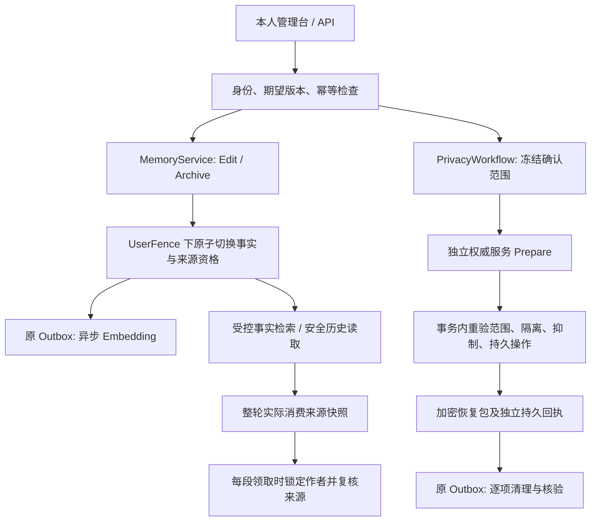

# Memory 生命周期与恢复架构

Memory 是同一 Bot 内属于本人的私人事实。实现复用 `Memory` 版本链、业务 `WonderDbContext` 和 Outbox；没有第二套事实版本链、任务队列或 Summary 投影表。群聊与共享记忆不参与该体系，主动表达不属于本模块。

## 模块边界



| 落点 | 职责 |
| --- | --- |
| `MemoryLifecycleService.cs` | 本人更正/归档、版本族校验、原子事实切换、持久 HTTP 回执 |
| `MemoryQueries.cs`、`MemoryService.cs` | 授权查询、当前事实筛选、向量与有界正文回退 |
| `ContentSources.cs`、`ContentSourceActors.cs` | 消费来源验证、实际依赖失效传播、资源作者锁解析 |
| `SummaryProjections.cs`、`SummaryWorkflow.cs` | 同表安全投影、正文/投影独立版本与条件写回 |
| `EvidencePolicy.cs`、`SafeReflectionEvidence.cs` | 旧断言抑制、当前确认与锚点校验、受控遮罩提取 |
| `PrivacyPlan.cs`、`PrivacyWorkflow.cs`、`PrivacyCleanup.cs` | 冻结精确范围、隔离、逐项清理、核验和续跑 |
| `RelationshipClaims.cs` | 关系单项来源与认知资格；保留独立边界和服务器权限 |
| `OutgoingWorkflow.cs` | 生成轮次来源复核、发送领取线性化、真实外部回执 |
| `RecoveryPackages.cs`、`RecoveryAuthorityClient.cs`、`RecoveryBootstrap.cs` | 恢复包、独立证明、精确重放、启动隔离 |

## 四种操作的边界

| 操作 | Memory 行为 | 原消息、媒体与原 Summary.Text | Notes / Relationship |
| --- | --- | --- | --- |
| Edit | 创建当前新版，归档并标记被正式取代的旧版；新正文立即生效 | 保留 | 独立正文保留，仅调整可证依赖的资格 |
| Archive | 退出当前事实检索；独立归档不标记过时 | 保留 | 独立正文保留，仅调整可证依赖的资格 |
| Forget | 清目标版本族及确切记忆副载荷，建立旧证据抑制 | 保留；不能宣称历史中同样内容已擦除 | 独立正文保留；隐私删除走其独立授权入口 |
| Erase | 在 Forget 基础上按确认清单处理完整本人私聊消息及可追溯派生资源 | 只清确认范围；不做消息片段擦除 | 不自动扩展到独立正文；未覆盖层明确报告 |

同 User、Bot、Session 或相同 FactKey 不能单独证明依赖。损坏或未知来源只阻断具体产物，不触发用户或会话范围的广域清理。旧 `RevokeAsync` 不承担更正职责；恢复重放不得回到旧广域清理路径。

## 版本、授权与幂等

`Memory` 复用 `SupersedesMemoryId`、`Revision`、`ArchivedAt`，以 `IsOutdated` 表示被后续正式事实取代。版本族的断链、环、分支或歧义会拒绝写入。新版创建、旧版资格变更、来源失效、回执和 Embedding 作业在同一事务提交。

- Update 与实际发生取代的 Supplement 标记旧版过时；Merge 保留正文并合并证据，不创造替代版本；独立 Archive 仅归档。
- 自动 Merge/Update/Archive 沿用原用户开关，独立 Archive 不增加逐条审批。人工 Edit 与自动维护权限分别校验。
- `RetainMemoryHistory` 沿用既有授权：允许保留时保留归档正文；关闭时清已授权的 Memory 历史及相关维护记录，不改聊天、Summary 或独立 Notes。
- 所有写入口从登录身份解析本人，不接受客户端指定 SubjectId。Bot Owner 权限不等于私人事实所有权。
- 所有操作使用 `expectedRevision` 和 `Idempotency-Key`。`MemoryOperations` 对 `(ActorId, IdempotencyKey)` 唯一，保存参数摘要和回执元数据，不复制待删正文。已提交的同键同参重试先回原操作；同键异参或版本冲突返回 409，缺版本/键返回 400。

`UserFence` 在短事务中锁定实际作者的逻辑用户行。外部模型、权威服务及平台发送不持有长 PG 事务；网络返回后重新校验版本、资格及租约。

## 受控检索与索引

当前事实必须同时满足本人、同 Bot、允许 Memory、未撤销、未归档、未过时和非空正文。索引状态不决定正文事实是否生效。

Embedding Profile 按 Bot、接口、模型、维度和版本隔离；向量带 `SourceRevision`。写回前重新核验源 Revision、当前 Profile、授权、归档/撤销状态、租约及到期时间。晚到结果不能覆盖当前索引。

有 Profile 但当前事实缺少向量时，检索合并最多 5 条未索引正文，去重后总数最多 5；供应商异常也使用相同授权下的有界回退。索引失败通过 Outbox 重试/死信和本人索引状态呈现，不恢复旧事实。旧无可信 Revision 的向量不参与当前召回，通过原 Outbox 重建。

## 来源与安全历史读取

`ContentSource(Kind, Id, Version)` 表示模型实际消费的资源：

| Kind | 版本身份 |
| --- | --- |
| Memory | Memory.Revision |
| Message | Text、SegmentsJson、ContextSnapshotJson 的内容指纹 |
| Summary | 正文 Revision |
| SummaryProjection | 独立 ProjectionRevision |
| Relationship | 关系 Revision、单项 ID/Revision 与实际安全投影的指纹 |

预算最终保留的参考组、引用消息与工具返回都进入该轮来源快照。Notes 沿用 `NoteDependency` 版本机制。每次模型续请求、最终写回、历史消费和发送领取重新验证来源。

旧 ID 集合只有部分溯源意义，不回填虚构版本；旧生成文本的全部来源集合为空、来源 JSON 损坏、资源缺失、循环或超出深度/数量上限时拒绝具体读取。来源图遍历限制为深度 16、资源 512。

失效沿实际 Memory→Message/Summary/投影及 Notes 依赖传播，不按 Session 扩大，不通过提高整个 Bot 设置版本取消无关生成。Relationship 投影自身也有来源版本；预算未消费的关系参考不加入来源。

## Summary 同表安全投影

- `SafeProjectionJson` 保存安全文本及实际来源；`SourcesJson` 保存正文来源。
- `ProjectionRevision`、`ProjectionBaseSummaryRevision`、`ProjectionState`、`ProjectionExpiresAt` 与正文 `Revision` 分离。
- 正常 Summary 更新同步作废旧投影，记录实际 BaseSummaryId/Revision，并替换本次消费的 Notes 依赖。
- 投影仅从合法当前证据重建；不把危险原 Summary.Text 先交给模型再要求脱敏。投影不能成为新的用户事实证据。
- 异步写回重新验证来源、授权、租约、正文与投影双版本 CAS；TTL 清理也带预期投影版本，不能误清新版或改原 Text。
- 重建投影不反转原 `ContextInvalidated` 冒充原摘要恢复有效；原文风险与投影可用性分别判断。

## 证据抑制与关系认知

`EvidenceSuppression` 绑定操作、Memory、原消息版本、FactKey 摘要及可证明 span，不构成永久 FactKey 黑名单。`EvidenceAssertion` 描述确切消息锚点、CurrentStatement / CurrentConfirmation / HistoricalQuote / Uncertain 角色及当前确认锚点。

旧引用不因时间较新就成为新证据；本人合法当前表达可以自动重新学习，无须额外“重新记录”指令。旧保留混合消息只有在版本和抑制范围均可证明时生成等宽遮罩提取视图；未知范围阻断提取。分批合并保留全部锚点，模型在途结果在持锁写入前重新过滤。

`RelationshipClaim` 为原 RelationshipState 提供每项来源、Explicit/Inferred/Unknown 类型及 Current/Tentative/Unverified/Blocked 资格。消息根去重，数量不是充分证据裁决。失源推断项降级；明确或 Unknown 的独立交流边界不因 Memory 删除而自动解除。关系文本不能改变工具权限、隐私授权或 /mute。Notes 原正文与修订链继续独立维护。

## 隐私操作、清单与续跑

`MemoryOperations` 记录冻结 `TargetsJson`、`ScopeHash`、阶段、隔离/清理/恢复三层核验和原始幂等字段。`MemoryOperationItems` 以操作/资源种类/ID 唯一，记录源版本、状态、错误码及核验时间。

1. Erase 预览从本人同 Bot 私聊证据构造完整消息及实际派生闭包，十分钟过期。确认包含消息中的全部事实损失；版本、作者、证据或范围变化要求重新预览。
2. 独立 Prepare 先可靠保存最小确认意图；随后在作者锁下复验范围，原子提交栅栏、抑制、最小账本、清单和原 Outbox 的 `memory-privacy` 作业。
3. 清目标族的所有向量 Profile、确切候选、生产 Reflection 的 Memory 子项、可证草稿与投影；不清独立关系/情绪子项。旧序列化兼容按完整断言和证据哈希，不按语义猜测。
4. 未证明的残余副载荷为 NeedsReview，相关 Memory 子源保持阻断。媒体核验 Bot、冻结版本、相对定位、共享路径、链接和真实内容哈希；文件 I/O 在持久认领后执行。URL 缓存 Hash 不等同文件 ContentHash。
5. 已完成项单调保留，重试只推进冻结范围内未完成项，不能偷扩或缩小确认范围。同步预算内全部核验通过返回 200，否则返回 202、持久 operationId 和查询位置。

整体 Completed 需要所有确认项目实际核验、清理与独立恢复保护全部满足。只读退役归档、旧备份、独立导出和外部 QQ 分别报告未覆盖；不能宣称所有副本都被擦除。

## 生成轮次与发送边界

每个分段继承所属生成轮次的完整实际来源。每次 Pending→Sending 前，在事务内核验任务租约及到期、来源版本、Notes 依赖和 disposition；从实际来源图解析作者，按顺序取得全部作者锁，再复核原来源版本。提示性 SourceUserIds 不能替代资源图解析。

删除先赢时不能领取相关 Pending；发送先赢时保留 Sent 或 DeliveryUnknown 的真实结果，停止该轮其余 Pending。无关来源轮次继续，不做未经证实的逐句归因、不伪造撤回、不自动重生成。平台调用在领取提交后进行，不能保证本地事务与外部 QQ 原子一致或严格 exactly-once。

## 迁移与恢复边界

迁移仅前向，保留操作回执、抑制与栅栏；不得回滚到旧广域删除二进制。独立 Prepare、加密恢复包、连续覆盖证明、精确重放和启动诊断的边界见 [独立恢复协议](#独立恢复协议)。

`MemoryLifecycleRelease` 为四项提供同一个配置入口。普通启动的恢复证明与实例、基线、公钥、权威服务地址及恢复密钥指纹绑定；配置开关不能替代证明，配置变化使原证明失效。失败时只有受限只读诊断或非零退出，不启动普通业务/Worker/QQ。配置和命令见 [运行指南](operations.md)。

## 独立恢复协议

恢复保护保证已承诺的删除不能因旧 PG 备份而静默复活。恢复包不替代数据库备份，独立最新度不能由待恢复的 PG、同目录配对文件或签名正确的旧包自证。

### 信任边界

| 组件 | 职责 |
| --- | --- |
| PostgreSQL | 在线事实、栅栏、操作清单、逐项进度和既有 typed 账本 |
| 加密 SQLite 与 JSON manifest | 一致切点的最小恢复快照及其认证元数据，不含业务正文或向量 |
| 独立权威服务 | 在不同恢复故障域持久保存最小意图、提交决定、包及连续覆盖证明 |
| 应用侧信任材料 | 已登记实例、首次可信基线、固定验签公钥、独立管理的解密密钥 |

独立服务必须可重建意图本身，或持有可取回的可靠对象；只存 OperationId/Hash 而把意图留在会丢失的 PG 中不足以恢复。应用只实现该服务的协议客户端；外部介质、私钥保管、权限、复制/落盘语义及首次基线需要通过部署环境验证。

### 配置

| 配置 | 含义 |
| --- | --- |
| `Recovery:InstanceId` | 独立登记的实例 UUID；包与服务回执均绑定它 |
| `Recovery:TrustedBaseline` | 独立保管的首次可信基线，不能临时从旧恢复库推导 |
| `Recovery:AuthorityUrl` | 独立权威服务 HTTPS 地址 |
| `Recovery:PinnedPublicKeyPem` | ECDSA 验签公钥；服务私钥与应用 PG 分离 |
| `Recovery:ArchiveKeyBase64` | 32 字节 AES 解密密钥，由受控秘密配置提供 |
| `Recovery:ArchiveKeyId` | 外部管理的加密密钥身份 |
| `Recovery:DiagnosticPort` | 受限 loopback 只读诊断端口，1024～65535 |
| `Recovery:DiagnosticTokenHash` | 管理员高熵 token 的 SHA-256 hex，配置中不保存明文 token |

加密密钥不能随包同盘保存而冒充独立保管；Data Protection 密钥环与恢复包 AES 密钥用途不同。轮换、目录迁移及介质变更必须重新验证包可解密、范围连续和信任材料一致。恢复保护记录不按辅助缓存 TTL 自动淘汰；淘汰需要覆盖备份窗口的独立证明。

### SQLite 与 manifest

`RecoveryPackages` 在 PG repeatable-read 下读取所有已建立栅栏的隐私操作、原幂等字段、项目清单、证据抑制和 typed 旧账本。SQLite 在内存构造，使用原生 serialize/deserialize 和 integrity_check；明文缓冲区与密钥使用后清零，不写明文临时 `.db`。

恢复记录只包含最小元数据：资源种类/ID/版本、作用域摘要、作者/Bot、已抑制原消息指纹与可证明 span、操作及项目状态、媒体相对定位和内容摘要。禁止保存待删 Memory/聊天/Notes/附件正文、向量或明文 FactKey。

SQLite 使用 AES-256-GCM 封装为 `.db.aesgcm`，配套 JSON manifest 保存格式版本、实例、schema、keyId、nonce/tag、密文摘要、操作覆盖摘要、基线与记录数。manifest 作为 AAD，实际解密及 SQLite 往返验证成功后才可请求独立 Protect。

targets 与 items 必须按 Kind/ID/源版本一一匹配；拒绝缺项、额外项、未知种类/状态、重复目标、不属于冻结 Memory 根的抑制记录。manifest 或密文损坏、错误实例/密钥/schema/基线、记录数及覆盖摘要不匹配均失败。

### 权威服务线协议

客户端 POST `v1/protection`：

```text
phase, instanceId, operationId, intentHash, challenge, baseline, payload
```

类型定义位于 Core `Recovery.cs` 和 Infrastructure `RecoveryAuthorityClient.cs`。各阶段必须满足：

| phase | 独立服务义务 |
| --- | --- |
| Prepare | 先可靠保存最小确认意图与未决状态；同实例/操作同参幂等，异参不得覆盖 |
| Commit | 在 PG 已建立栅栏后确认提交决定 |
| Abort | 只有明确证明 PG 回滚才能取消；连接丢失等不明确结果不得猜测 Abort |
| Protect | 校验快照覆盖，可靠发布实际密文包及 manifest 后才签发持久回执 |
| Verify | 对照独立最新记录检查实例/schema/基线、连续完整覆盖、后续删除、未决意图及序列缺口；不得只回显请求 |

Prepare 在 PG 栅栏事务之前执行，不在持锁事务中等待外部服务。PG 提交后先确认独立恢复保护，再逐项推进剩余物理清理；Memory 及向量的同步栅栏/清除已有独立 Prepare 的最小可重放意图保护。

普通意图摘要为 `SHA256(Json(intent))`。Protect 请求的摘要同时绑定实际材料：

```text
SHA256(Json({ intentHash: SHA256(Json(intent)), archiveDigest, manifestDigest }))
```

Verify 的 operationId 为全零 UUID，摘要绑定整个 `RecoveryCoverage`，含 schema、baseline、现代意图集合摘要和 typed 旧账本摘要。生成时间或最高数字本身不是最新度证明。

服务返回 `SignedAuthorityReply(instanceId, operationId, phase, intentHash, challenge, sequence, durable, pendingIntents, signature)`。签名输入是相同字段顺序的 camelCase JSON、signature 为空字符串的 UTF-8 字节，SHA-256 ECDSA（.NET 默认 P1363 编码）后 Base64；跨语言实现需要固定向量对照，不能自行变更 JSON 规范化。

客户端核验固定公钥签名、随机 challenge、实例/操作/phase/摘要、非负序列及 durable；Verify 要求 pendingIntents=0。新 nonce 只能防止旧响应重放，不能替代独立服务自身的持久性与连续覆盖语义。

### 中断与恢复规则

| 中断窗口 | 安全处理 |
| --- | --- |
| Prepare 未确认 | 不提交新的隐私栅栏或不可逆删除 |
| Prepare 已确认，PG 结果不明 | 保留独立未决意图，正常恢复阻断，不能推断取消 |
| PG 栅栏已提交，包或 Protect 未确认 | 保持隔离和持久 operationId，不报告整体完成，幂等继续保护 |
| Protect 已确认，物理项未完成 | 仅续跑冻结范围的未完成项；清单不扩缩 |
| 文件已删，item 未提交 | 按冻结定位/版本重验，文件缺失可幂等核验；共享/变更文件保持待核验 |
| 旧 PG 恢复或 Completed 标记被恢复 | 先用独立最新材料验证覆盖，精确重放并复核实际栅栏和载荷，不信任旧完成标记 |
| 包/manifest/密钥/锚点丢失或过旧 | 受限诊断或停机，不启用普通业务 |

### 离线接口与精确重放

Host 二进制支持：

```text
--export-recovery-package <new.db.aesgcm> <new.manifest.json>
--replay-recovery-package <db.aesgcm> <manifest.json>
--verify-recovery
```

命令在普通 app.Run/HostedService 之前执行；导出使用 CreateNew 拒绝覆盖文件。文件导出成功不等于已取得 Protect 回执。执行目标必须是经过批准的运维环境，恢复顺序为 stop → restore → migrate → 必要的旧类型转换 → 最新独立材料重放 → verify → start。

重放仅按冻结 ID/版本，保留原 HTTP 幂等字段，重建抑制与隔离，物理项目重新待核验并交给原 Outbox。重复重放不能按相同 FactKey 摘要删除后续合法新事实。旧 Memory/Note 记录先检查真实 Bot/本人；Unknown MemoryContext 或 hash-only 范围不能升级为广域擦除授权。

### 普通启动与只读诊断

`RecoveryBootstrap` 验证配置、schema、清单一致性、实际 Memory/Message/Summary 栅栏、已完成项目残留及独立覆盖证明。残余 Memory 副载荷无法重新证明安全时继续阻断；不能因曾经 Completed 而跳过，也不能因此扩大清理范围。

恢复失败不启动 Chat、Reflection、MemoryMaintenance、Summary、Outgoing、QQ、Quartz、普通用户 API 或 SPA。`RecoveryDiagnostics` 独立监听 loopback，公众只见通用标题和诊断 ID；管理员以 token 鉴权读取脱敏的类型、阶段、时间、真实 inner 链及捕获调用帧。任意异常消息/Data/敏感路径不直接输出。

诊断配置非法、无法建立可靠鉴权或诊断网页启动失败时，仅输出脱敏本机诊断并退出 78。修复后从恢复基线重新完整校验，不能通过关闭 Worker、修改业务开关或启动旧二进制绕过检查。

## 验收约束

验收围绕下列不变量进行，执行方式见 [测试指南](../tests/README.md)。

### 不变量与测试落点

| 约束 | 关键断言 | 测试落点 |
| --- | --- | --- |
| 精确范围与本人权限 | 多事实、多 Session、跨 Bot/作者哨兵；只改确认族及实际依赖；Owner 不越权 | MemoryLifecycleTests、PrivacyTests、PrivacyBoundaryTests、ApiTests |
| 版本与历史授权 | Edit/Update/取代 Supplement 原子过时；Merge/独立 Archive 不过时；RetainMemoryHistory 不扩展为聊天清理 | MemoryLifecycleTests、MemoryMaintenanceTests |
| 新正文与索引分离 | 无当前向量/供应商失败仍有有界授权回退；旧 Revision/Profile/租约结果不写回 | MemoryLifecycleTests、LiveInfrastructureTests |
| 实际来源与安全历史 | 引用/工具返回/预算保留项有 ID/版本；只沿实际链失效；损坏/空旧来源阻断具体产物 | MemoryLifecycleTests、ConversationContinuityTests、PrivateContextTests |
| 同表 Summary 投影 | 原 Text/正文 Revision 不因投影改变；正常更新使投影失效；来源/租约/双版本 CAS 和 TTL 不误写新版 | MemoryLifecycleTests |
| Notes、关系与情绪独立性 | 独立正文/修订保留；失源推断降级，Explicit/Unknown Boundary 不被解除；不改变权限或 /mute | PrivacyTests、PrivacyBoundaryTests、AgentAutonomyTests |
| 旧证据与当前确认 | 旧引用不洗成新证据；当前确认和独立新事实可再学；同源多批次保留全部锚点 | PrivacyTests、PrivacyBoundaryTests、ReflectionEvidenceTests |
| 持久幂等与冲突 | 缺版本/键拒绝、同键同参返回原操作、异参 409、跨工厂重试仍幂等 | MemoryLifecycleTests、PrivacyTests、MemoryReleaseTests |
| Erase 完整消息与逐项续跑 | 预览过期/变更/跨身份拒绝；A/B 完成、C 失败不能整体 Completed；文件/DB 不同水位可恢复 | PrivacyTests、PrivacyBoundaryTests |
| 混合副载荷与兼容 | 只清精确 Memory 子项，保留关系/情绪；兼容旧 Assertions 哈希形状，未知残留待核验 | PrivacyTests、PrivacyBoundaryTests |
| 整轮发送线性化 | 用 PG barrier 控制删除先赢/发送先赢；两 Memory 三段停相关 Pending、独立轮次继续、Sent/Unknown 保真 | PrivacyBoundaryTests、InteractionTests |
| 恢复包与完整清单 | 原生 SQLite 与 AEAD 实际往返；错密钥/实例/篡改/缺项/错源版本/未知类型拒绝 | PrivacyTests、RecoveryBoundaryTests |
| 独立恢复与重复重放 | 签名/nonce/覆盖绑定及未决意图拒绝；重放两次不扩范围、不误删合法新事实 | RecoveryBoundaryTests、PrivacyTests、ArchiveCutoverTests |
| 失败诊断隔离 | 真实二进制失败分支中业务端口不监听、数据库探针零连接、无普通 API/SPA；鉴权、真实栈脱敏及非零退出 | RecoveryBoundaryTests |
| 统一入口与前端契约 | 四项共用配置及恢复证明；配置变更失效；完整消息确认、409、逐项进度和重试不虚报成功 | MemoryReleaseTests、memory-lifecycle.spec.ts |

这些测试映射对应 D-01～D-07、D-04.1～10、Q-01～04、S-01～04、INV-01～17 与 AC-01～50 的相关断言，不意味着模拟测试可替代全部环境保证。

### 环境与证据要求

- PostgreSQL/pgvector 的迁移、锁、向量、CAS 和竞争必须使用经过验证的隔离 PG，不能用 SQLite 代替。TestPostgres 先要求 postgres 管理库及显式实例标识匹配，再创建随机临时库；测试释放自己的数据库。
- TestApp 去除 HostedService，使用模拟模型和发送器。生产环境路径测试可验证真实 Bootstrap/HTTP，但模拟 authority 不能证明真实独立恢复服务。
- BrowserHost 只有静态资源、CSP、SPA 回退与健康探针；浏览器 API mock 不能证明后端业务或恢复保障。
- 中文引用、确认、否定、反讽、时态和偏好/边界语义需要单独的真实模型样本评估；固定规则样本不能视为模型误判率。
- 独立介质/密钥/首次基线、连续最新度、备份窗口、所有中断点、目标主机 ACL 和真实 QQ 回执需环境验收。签名有效但过旧的包、缺锚点、丢密钥与未决意图均必须保守失败。
- 原库、真实 Host/Worker/QQ 及外部账户不得成为自动测试的默认目标。测试输出不复制待删正文、密钥、令牌、连接串或敏感异常数据。
