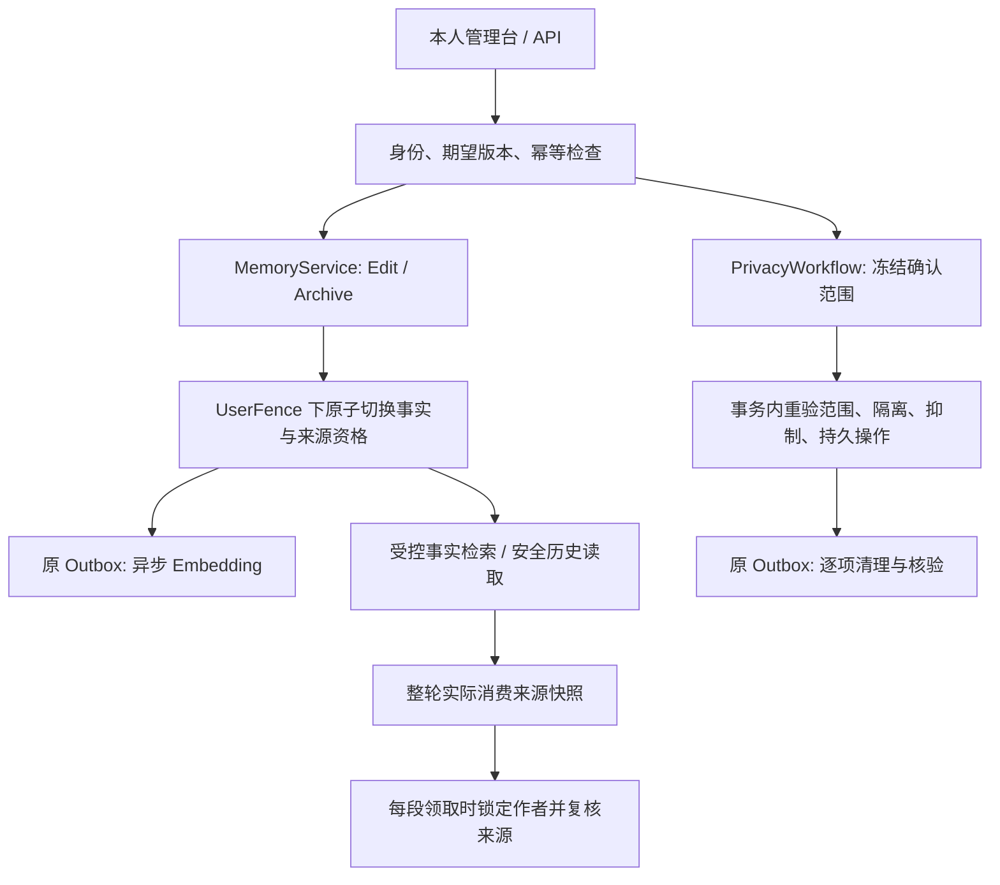

# Memory 生命周期与在线清理架构

Memory 是同一 Bot 内属于本人的私人事实。实现复用 `Memory` 版本链、业务 `WonderDbContext` 和 Outbox；没有第二套事实版本链、任务队列或 Summary 投影表。群聊不参与该体系。已绑定本人可直接管理已有记忆；“允许记忆”和自动维护开关不限制人工操作，只控制后续自动学习与维护。

## 模块边界

| 落点 | 职责 |
| --- | --- |
| `MemoryLifecycleService.cs` | 本人更正/归档、版本族校验、原子事实切换、持久 HTTP 回执 |
| `MemoryQueries.cs`、`MemoryService.cs` | 授权查询、当前事实筛选、向量与有界正文回退 |
| `ContentSources.cs`、`ContentSourceActors.cs` | 消费来源验证、实际依赖失效传播、资源作者锁解析 |
| `SummaryProjections.cs`、`SummaryWorkflow.cs` | 同表安全投影、正文/投影独立版本与条件写回 |
| `EvidencePolicy.cs`、`SafeReflectionEvidence.cs` | 旧断言抑制、当前确认与锚点校验、受控遮罩提取 |
| `PrivacyPlan.cs`、`PrivacyWorkflow.cs`、`PrivacyCleanup.cs` | 冻结精确范围、隔离、逐项清理、核验和续跑 |
| `RelationshipClaims.cs` | 关系单项来源与认知资格；保留独立边界和服务器权限 |
| `OutgoingWorkflow.cs` | 生成轮次来源复核、发送领取线性化、真实外部回执 |

## 四种操作的边界

| 操作 | Memory 行为 | 原消息、媒体与原 Summary.Text | Notes / Relationship |
| --- | --- | --- | --- |
| Edit | 创建当前新版，归档并标记被正式取代的旧版；新正文立即生效 | 保留 | 独立正文保留，仅调整可证依赖的资格 |
| Archive | 退出当前事实检索；独立归档不标记过时 | 保留 | 独立正文保留，仅调整可证依赖的资格 |
| Forget | 清目标版本族及确切记忆副载荷，建立旧证据抑制 | 保留；不能宣称历史中同样内容已擦除 | 独立正文保留；隐私删除走其独立授权入口 |
| Erase | 在 Forget 基础上按确认清单处理完整本人私聊消息及可追溯派生资源 | 只清确认范围；不做消息片段擦除 | 不自动扩展到独立正文；未覆盖层明确报告 |

同 User、Bot、Session 或相同 FactKey 不能单独证明依赖。损坏或未知来源只阻断具体产物，不触发用户或会话范围的广域清理。

## 版本、授权与幂等

`Memory` 复用 `SupersedesMemoryId`、`Revision`、`ArchivedAt`，以 `IsOutdated` 表示被后续正式事实取代。版本族的断链、环、分支或歧义会拒绝写入。新版创建、旧版资格变更、来源失效、回执和 Embedding 作业在同一事务提交。

- Update 与实际发生取代的 Supplement 标记旧版过时；Merge 保留正文并合并证据，不创造替代版本；独立 Archive 仅归档。
- 自动 Merge/Update/Archive 沿用原用户开关，独立 Archive 不增加逐条审批。本人手动操作与自动维护分别校验，自动维护开关不限制本人手动管理。
- `RetainMemoryHistory` 沿用既有授权：允许保留时保留归档正文；关闭时清已授权的 Memory 历史及相关维护记录，不改聊天、Summary 或独立 Notes。
- 所有写入口从登录身份解析本人，不接受客户端指定 SubjectId。Bot Owner 权限不等于私人事实所有权。
- 所有操作使用 `expectedRevision` 和 `Idempotency-Key`。`MemoryOperations` 对 `(ActorId, IdempotencyKey)` 唯一，保存参数摘要和回执元数据，不复制待删正文。已提交的同键同参重试先回原操作；同键异参或版本冲突返回 409，缺版本/键返回 400。

`UserFence` 在短事务中锁定实际作者的逻辑用户行。外部模型与平台发送不持有长 PG 事务；网络返回后重新校验版本、资格及租约。

## 受控检索与索引

当前事实必须同时满足本人、同 Bot、允许 Memory、未撤销、未归档、未过时和非空正文。索引状态不决定正文事实是否生效。

Embedding Profile 按 Bot、接口、模型、维度和版本隔离；向量带 `SourceRevision`。写回前重新核验源 Revision、当前 Profile、授权、归档/撤销状态、租约及到期时间。晚到结果不能覆盖当前索引。

有 Profile 但当前事实缺少向量时，检索合并最多 5 条未索引正文，去重后总数最多 5；供应商异常也使用相同授权下的有界回退。索引失败通过 Outbox 重试/死信和本人索引状态呈现，不恢复旧事实。向量的来源 Revision 必须与当前正文一致。

## 来源与安全历史读取

`ContentSource(Kind, Id, Version)` 表示模型实际消费的资源：

| Kind | 版本身份 |
| --- | --- |
| Memory | Memory.Revision |
| Message | Text、SegmentsJson、ContextSnapshotJson 的内容指纹 |
| Summary | 正文 Revision |
| SummaryProjection | 独立 ProjectionRevision |
| Relationship | 关系 Revision、单项 ID/Revision 与实际安全投影的指纹 |

预算最终保留的参考组、引用消息与工具返回都进入该轮来源快照。Notes 沿用 `NoteDependency` 版本机制。每次模型续请求、最终写回、历史消费和发送领取重新验证来源。

摘要正文使用 `SourcesJson`，安全投影使用 `SafeProjectionJson.Sources`，生成消息的上下文快照使用 `ContextSnapshot.Sources`。这些记录必须提供当前格式的来源列表；缺失或损坏时拒绝使用，即使旧 ID 索引指向的记录仍然存在，也不重建来源或补造版本。显式空列表与缺失来源不同；没有上下文快照的原始用户消息按原消息及证据抑制规则校验。

ID 集合继续用于查询与失效索引，不能替代 ContentSource 来源和版本。资源缺失、循环或超出深度/数量上限时同样拒绝具体读取；来源图遍历设有深度 16、资源约 512 的保护上限。

失效沿实际 Memory→Message/Summary/投影及 Notes 依赖传播，不按 Session 扩大，不通过提高整个 Bot 设置版本取消无关生成。Relationship 投影自身也有来源版本；预算未消费的关系参考不加入来源。

## Summary 同表安全投影

- `SafeProjectionJson` 保存安全文本及实际来源；`SourcesJson` 保存正文来源。
- `ProjectionRevision`、`ProjectionBaseSummaryRevision`、`ProjectionState`、`ProjectionExpiresAt` 与正文 `Revision` 分离。
- 正常 Summary 更新同步作废旧投影，记录实际 BaseSummaryId/Revision，并替换本次消费的 Notes 依赖。
- 投影仅从合法当前证据重建；不把危险原 Summary.Text 先交给模型再要求脱敏。投影不能成为新的用户事实证据。
- 异步写回重新验证来源、授权、租约、正文与投影双版本 CAS；TTL 清理也带预期投影版本，不能误清新版或改原 Text。
- 重建投影不反转原 `ContextInvalidated` 冒充原摘要恢复有效；原文风险与投影可用性分别判断。

## 证据抑制与关系认知

`EvidenceSuppression` 绑定操作、Memory、原消息版本、FactKey 摘要及可证明 span，不构成永久 FactKey 黑名单。`EvidenceAssertion` 描述确切消息锚点、CurrentStatement / CurrentConfirmation / HistoricalQuote / Uncertain 角色及当前确认锚点。

旧引用不因时间较新就成为新证据；本人合法当前表达可以自动重新学习，无须额外“重新记录”指令。旧保留混合消息只有在版本和抑制范围均可证明时生成等宽遮罩提取视图；未知范围阻断提取。分批合并保留全部锚点，模型在途结果在持锁写入前重新过滤。

`RelationshipClaims` 是关系声明的唯一来源，提供每项来源、Explicit/Inferred/Unknown 类型及 Current/Tentative/Unverified/Blocked 资格；`RelationshipState` 仅保留标识、归属和 Revision，不保存偏好或边界数组。写入端合并每项证据并推进声明和关系 Revision，明确提案会将该项 Origin 标记为 Explicit。

投影排除 Blocked 项，对其他普通声明检查消息、记忆及证据抑制状态；Tentative / Unverified 仅作为非事实参考。消息根去重，数量不是充分证据裁决。失源推断项降级；明确或 Unknown 的独立交流边界不因 Memory 删除而自动解除。关系文本不能改变工具权限、隐私授权或静音状态。Notes 原正文与修订链继续独立维护。

## 隐私操作、清单与续跑

`MemoryOperations` 记录冻结 `TargetsJson`、`ScopeHash`、阶段、隔离/在线清理核验和原始幂等字段。`MemoryOperationItems` 以操作/资源种类/ID 唯一，记录源版本、状态、错误码及核验时间。

1. Erase 预览从本人同 Bot 私聊证据构造完整消息及实际派生闭包，十分钟过期。确认包含消息中的全部事实损失；版本、作者、证据或范围变化要求重新预览。
2. 在作者锁下复验范围，原子提交栅栏、抑制、数据库撤销记录、清单和原 Outbox 的 `memory-privacy` 作业，不等待外部服务。
3. 清目标族的所有向量 Profile、确切候选、生产 Reflection 的 Memory 子项、可证草稿与投影；不清独立关系/情绪子项。候选匹配使用当前 `MemoryCandidate` 序列化哈希，不尝试旧的缺字段哈希形状；未知残留继续阻止完成。防回写依据当前 `EvidenceSuppression` 的确切证据范围，不回退到旧的仅 FactKey 哈希撤销记录。
4. 未证明的残余副载荷为 NeedsReview，相关 Memory 子源保持阻断。媒体核验 Bot、冻结版本、相对定位、共享路径、链接和真实内容哈希；文件 I/O 在持久认领后执行。URL 缓存 Hash 不等同文件 ContentHash。
5. 已完成项单调保留，重试只推进冻结范围内未完成项，不能偷扩或缩小确认范围。同步预算内全部核验通过返回 200，否则返回 202、持久 operationId 和查询位置。

整体 Completed 需要所有确认项目的在线清理核验完成。历史备份、独立导出和外部 QQ 分别报告未覆盖；不能宣称所有副本都被擦除。

## 生成轮次与发送边界

每个分段继承所属生成轮次的完整实际来源。每次 Pending→Sending 前，在事务内核验任务租约及到期、来源版本、Notes 依赖和 disposition；从实际来源图解析作者，按顺序取得全部作者锁，再复核原来源版本。提示性 SourceUserIds 不能替代资源图解析。

删除先赢时不能领取相关 Pending；发送先赢时保留 Sent 或 DeliveryUnknown 的真实结果，停止该轮其余 Pending。无关来源轮次继续，不做未经证实的逐句归因、不伪造撤回、不自动重生成。平台调用在领取提交后进行，不能保证本地事务与外部 QQ 原子一致或严格 exactly-once。

## 迁移与运维恢复

当前数据库只有 `InitialCreate` 基线，首次应用需空库；已使用相同基线时可重复检查迁移。旧迁移链的开发库必须手动重建，不提供旧版本库的升级、导入或回填。当前模型继续保存操作回执、证据抑制、业务撤销记录、记忆版本链和 Notes 历史，这不代表能够迁入旧库的数据。

备份和恢复由运维使用外部 PostgreSQL 工具处理，详见 [运行指南](operations.md#运维备份与恢复)。恢复旧备份后的数据状态以备份时点为准，不自动重放后续删除；备份之后删除过的数据可能重新出现。数据库之外需保存 Data Protection 密钥目录，需要图片时另行保存媒体目录。

## 验收约束

验收围绕下列不变量进行，执行方式见 [测试指南](../tests/README.md)。

### 不变量与测试落点

| 约束 | 关键断言 | 测试落点 |
| --- | --- | --- |
| 精确范围与本人权限 | 多事实、多 Session、跨 Bot/作者哨兵；只改确认族及实际依赖；Owner 不越权 | MemoryLifecycleTests、PrivacyTests、PrivacyBoundaryTests、ApiTests |
| 版本与历史授权 | Edit/Update/取代 Supplement 原子过时；Merge/独立 Archive 不过时；RetainMemoryHistory 不扩展为聊天清理 | MemoryLifecycleTests、MemoryMaintenanceTests |
| 新正文与索引分离 | 无当前向量/供应商失败仍有有界授权回退；旧 Revision/Profile/租约结果不写回 | MemoryLifecycleTests、LiveInfrastructureTests |
| 实际来源与安全历史 | 引用/工具返回/预算保留项有 ID/版本；只沿实际链失效；缺失/损坏来源阻断具体产物 | MemoryLifecycleTests、ConversationContinuityTests、PrivateContextTests |
| 同表 Summary 投影 | 原 Text/正文 Revision 不因投影改变；正常更新使投影失效；来源/租约/双版本 CAS 和 TTL 不误写新版 | MemoryLifecycleTests |
| Notes、关系与情绪独立性 | 独立正文/修订保留；失源推断降级，Explicit/Unknown Boundary 不被解除；不改变权限或静音状态 | PrivacyTests、PrivacyBoundaryTests、AgentAutonomyTests |
| 旧证据与当前确认 | 旧引用不洗成新证据；当前确认和独立新事实可再学；同源多批次保留全部锚点 | PrivacyTests、PrivacyBoundaryTests、ReflectionEvidenceTests |
| 持久幂等与冲突 | 缺版本/键拒绝、同键同参返回原操作、异参 409、跨工厂重试仍幂等 | MemoryLifecycleTests、PrivacyTests、MemoryReleaseTests |
| Erase 完整消息与逐项续跑 | 预览过期/变更/跨身份拒绝；A/B 完成、C 失败不能整体 Completed；文件/DB 不同水位可恢复 | PrivacyTests、PrivacyBoundaryTests |
| 混合副载荷清理 | 只清精确 Memory 子项，保留关系/情绪；按当前 Assertions 格式精确匹配哈希，未知残留待核验 | PrivacyTests、PrivacyBoundaryTests |
| 整轮发送线性化 | 用 PG barrier 控制删除先赢/发送先赢；两 Memory 三段停相关 Pending、独立轮次继续、Sent/Unknown 保真 | PrivacyBoundaryTests、InteractionTests |
| 统一入口与前端契约 | 无恢复配置时四项可用；关闭自动学习仍可管理；完整消息确认、409、逐项进度和重试不虚报成功 | MemoryReleaseTests、memory-lifecycle.spec.ts |
| 数据库基线 | 空库及重复迁移、模型一致性；无退役 schema、Quartz 表与旧业务结构 | LiveInfrastructureTests |

这些测试验证在线权限、精确范围及清理结果；运维备份恢复需另行演练。

### 环境与证据要求

- PostgreSQL/pgvector 的迁移、锁、向量、CAS 和竞争必须使用经过验证的隔离 PG，不能用 SQLite 代替。TestPostgres 先要求 postgres 管理库及显式实例标识匹配，再创建随机临时库；测试释放自己的数据库。
- TestApp 去除 HostedService，使用模拟模型和发送器。生产环境路径测试验证正常启动与 HTTP 操作，不需要恢复替身。
- BrowserHost 只有静态资源、CSP、SPA 回退与健康探针；浏览器 API mock 不能证明后端业务。
- 中文引用、确认、否定、反讽、时态和偏好/边界语义需要单独的真实模型样本评估；固定规则样本不能视为模型误判率。
- 数据库、Data Protection 密钥、媒体的外部备份与恢复、目标主机 ACL 和真实 QQ 回执需环境验收。
- 原库、真实 Host/Worker/QQ 及外部账户不得成为自动测试的默认目标。测试输出不复制待删正文、密钥、令牌、连接串或敏感异常数据。
