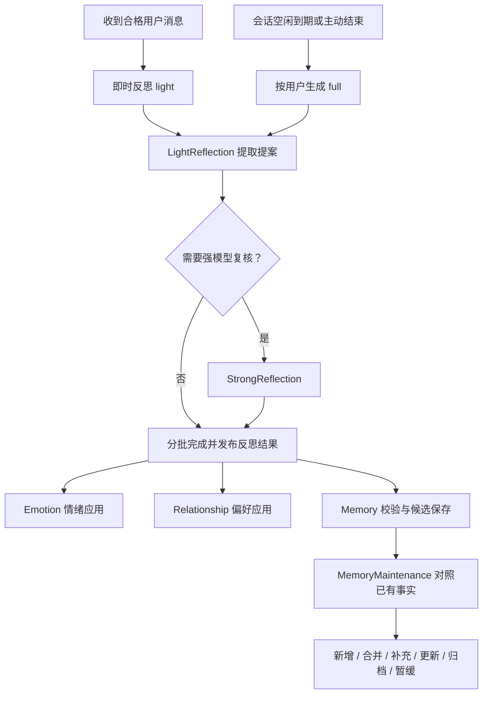

# Reflection 与 Memory 触发机制

Reflection 在后台从用户消息中提取提案；Memory 校验事实候选，再交给维护任务决定是否写入或更新长期记忆。聊天与反思分别排队，当前回复不会等待反思完成，新记忆通常影响后续对话。

## 消息到记忆的链路

## 即时反思 light

每条同时满足以下条件的消息都会排入任务，不按累计消息数触发，也不需要等聊天回复成功：

- Bot 已启用，且允许消息持久化。
- 消息符合回复规则；私聊通常直接满足，群聊需要符合 @ Bot、回复 Bot 或命令前缀规则。
- 发言用户开启 `AllowMemory`，该设置默认关闭。
- 群聊策略还需开启 `PersistMessages` 和 `AllowReflection`。

即时反思只分析当前用户的这一条消息。普通群消息即使被保存，只要没有触发回复，就不会自动参与反思，也不会被纳入该 Session 的 full 反思。

当前 `AllowMemory` 同时约束反思生成及情绪、关系、记忆结果的应用，并非只控制最终事实落库。

## 会话结束反思 full

| 条件 | 当前行为 |
| --- | --- |
| 空闲到期 | 私聊、群聊默认均为 10 分钟，可按 Bot 配置；触发回复的入站消息延后截止时间 |
| 主动结束 | `/end` 或 `/结束` 将当前 Session 截止时间设为现在；消息仍需符合回复和持久化规则 |
| 检查与排队 | Quartz 每 15 秒扫描到期 Session，等待该 Conversation 的聊天和发送任务完成 |

扫描固定会话结束的消息边界，并为每位具有可反思消息、且仍开启长期记忆的用户分别排入 full。分析范围是该 Session 内、截至边界、属于该用户且允许反思的消息，不把助手回复或他人发言当成本人事实。

full 会覆盖已经做过 light 的消息。候选去重、事实合并和情绪证据检查用于限制重复应用。会话扫描等待相关 Reflection / Emotion / Relationship / Memory 的 Pending、Running 任务消失后关闭 Session；MemoryMaintenance 不属于等待条件，DeadLetter 也不继续阻塞会话关闭。

## 模型选择与长输入

`light` / `full` 表示分析范围，`LightReflection` / `StrongReflection` 表示模型路由。full 不会直接跳过轻量模型。

两种任务都先调用 LightReflection，返回 `needsStrongReview`、`emotion`、`relationships` 和 `memories`。模型要求复核时，才调用 StrongReflection；复核后仍要求进一步复核的片段不采纳为有效提案。

长输入按各自模型预算分批或分片，保存游标、来源指纹和中间结果。所有批次结束后发布一份 ReflectionResult，再创建三类下游任务。来源撤回、正文变化或授权失效会阻止旧结果提交。提案可以为空，反思成功不保证产生记忆。

预算、分片及恢复见 [统一上下文预算](context-budget.md)。

## 反思结果的应用

| 任务 | 准入和效果 |
| --- | --- |
| Emotion | 检查证据；与最近检查范围内已应用事件证据重叠时不重复应用；每用户对同一 Bot 每 UTC 日最多 5 次 |
| Relationship | 明确偏好或至少 3 条独立消息证据才能准入；按 Bot / 用户 / 群范围保存，最多保留最近 20 项 |
| Memory | 要求明确、非敏感、正文和 FactKey 合法、具有本人消息证据、授权版本有效，且未命中删除记录；只保存隔离候选 |

Memory 候选正文上限 1000 字符、FactKey 上限 150 字符。同一反思里的完全重复候选只排入一个维护任务。

## 从候选到正式记忆

MemoryMaintenance 是候选触发的任务，不是固定时间全库扫描：

1. 正文与已有事实完全相同，直接合并证据，不调用模型。
2. 其他候选生成向量，在同 Bot、本人及同一作用域内召回 Top 10，并加入同 FactKey 的事实。
3. 没有相关事实可直接新增；存在相关事实则调用 StrongReflection 判断操作，没有相似度阈值自动合并规则。
4. 服务端根据用户开关、证据时间、授权、来源和并发状态再次核验，再提交或暂缓。

向量 Profile 改变时，缺少的已有事实向量先补建，维护任务等待后重新检查。候选在正式准入前不参与聊天检索；不确定的事实可暂缓，已有记忆保留。详细决策、版本与共享撤回规则见 [自主维护记忆](memory-maintenance.md)。

## 其他任务与故障

- 每日维护推进模拟心境并生成叙事，不定时重跑整套 Reflection / Memory。
- 滚动摘要是对话上下文压缩，与长期事实记忆分开。
- 模型路由、密钥、供应商错误和额度会影响后台处理；修复和重试见 [运行指南](operations.md#任务失败与重试)。

## 代码入口

| 文件 | 职责 |
| --- | --- |
| [OneBotProtocol.cs](../src/Wonder.Platforms/OneBotProtocol.cs) | 保存、回复及反思触发判断 |
| [MessageIngestor.cs](../src/Wonder.Host/Features/Chat/MessageIngestor.cs) | 会话活动、截止时间与 light 创建 |
| [MaintenanceWorkflow.cs](../src/Wonder.Host/Jobs/MaintenanceWorkflow.cs) | 会话扫描、full 创建和关闭 |
| [ReflectionWorkflow.cs](../src/Wonder.Host/Features/Memory/ReflectionWorkflow.cs) | 反思生成、复核、结果应用和候选创建 |
| [MemoryMaintenanceWorkflow.cs](../src/Wonder.Host/Features/Memory/MemoryMaintenanceWorkflow.cs) | 事实召回和维护决策 |
